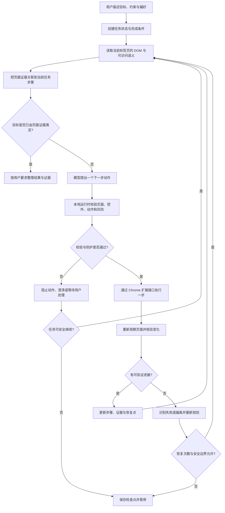
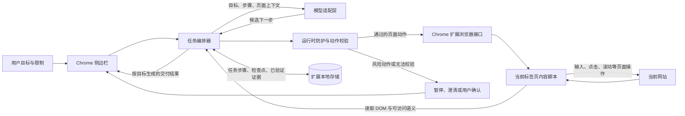

# Browser Agent

  
  <h3>让浏览器理解目标，按步骤完成任务，并用页面证据确认结果。</h3>
  
🧩 Chrome 扩展　·　🌐 DOM 页面理解　·　🛡️ 用户掌控

Browser Agent 是一个 Chrome 扩展。你用自然语言描述目标和限制，它读取当前标签页中可见的网页结构，规划下一步，经过本地运行时校验后操作页面，再检查页面变化是否符合目标。任务需要登录、缺少关键信息或即将产生重要外部影响时，它会暂停并把决定权交还给你。

> **一句话理解：** 模型负责提出下一步；浏览器运行时负责核对页面目标、动作边界和执行结果；页面证据决定任务能否继续或结束。

## 安装与首次配置

### 下载并加载扩展

1. 下载本仓库根目录中的 `browser-agent-dom-1.0.zip`。
2. 将压缩包解压到一个固定位置。不要直接选择 ZIP，也不要选择外层临时目录；应选择解压后**直接包含 `manifest.json`** 的文件夹。
3. 在 Chrome 地址栏打开 `chrome://extensions`。
4. 打开页面右上角的“开发者模式”。
5. 点击“加载已解压的扩展程序”，选择刚才确认过的扩展根文件夹。
6. 固定 Browser Agent 图标，打开目标网站，再从 Chrome 侧边栏打开 Browser Agent。

更新扩展时，先解压新版到一个固定文件夹，再在扩展管理页重新加载该目录。保留原来的扩展配置目录，除非你明确要清除配置。

### 配置模型提供商

在扩展设置中选择兼容协议，并填写模型提供商的 Base URL、模型 ID 和 API 密钥，然后使用设置页的连接测试。配置只应填写在扩展界面，不要放进代码、仓库、截图或问题报告。扩展发布包不包含任何测试用密钥或本机评测配置。

执行任务时，扩展会将任务目标和完成任务所需的页面上下文发送给你配置的模型提供商。请根据该提供商的隐私与数据处理政策选择是否使用。

## 它能做什么

| 能力 | 行为 |
| --- | --- |
| 读懂当前页面 | 根据可见文本、链接、输入框、按钮、控件角色和可访问名称构建页面上下文。 |
| 拆解多步目标 | 把目标、顺序、约束和完成条件组织成有进度的任务步骤。 |
| 结合目标选控件 | 选择当前步骤相关的页面元素，而不是只按固定按钮脚本执行。 |
| 安全执行操作 | 在本地运行时检查目标页面、控件和动作是否匹配任务，再调用浏览器接口。 |
| 观察并核验 | 操作后重新读取页面；只有页面证据支持的进展才会写入任务状态。 |
| 暂停与恢复 | 遇到登录、缺少必要信息、外部影响操作或无法安全推进时保存检查点并等待处理。 |
| 按要求总结 | 根据用户原始目标、已核验结果和未完成项组织交付说明。 |

常见用途包括站内搜索、信息整理、网页表单填写、跨页面资料查找，以及需要按顺序完成并逐步核验的浏览器工作流。网站结构、登录状态、浏览器限制和提供商能力都会影响最终效果。

## 任务如何执行

每个任务按“理解目标 → 观察页面 → 规划一步 → 校验 → 操作 → 复核”的闭环推进。遇到导航或动态页面变化后，智能体重新观察新页面，并结合还未完成的目标继续规划；它不会把模型的一句回复直接当成页面操作成功的证据。

### 页面动作的核验方式

1. **确认当前目标。** 当前任务步骤定义这一步要找什么、做什么，以及怎样才算成功。
2. **定位页面线索。** 从当前页面中提取与目标相关的文本、控件角色、可访问名称、链接和表单字段。
3. **选定操作对象。** 模型给出的动作必须能对应到当前页面观察到的目标元素。
4. **运行时把关。** 本地规则检查动作类型、元素引用、所在标签页及潜在副作用；不符合条件时不执行。
5. **复查结果。** 动作后重新读取页面，用新页面状态判断是否完成了当前步骤、是否需要回退或改走其他相关页面。
6. **更新任务进度。** 保存已验证证据、剩余目标和可恢复位置，避免导航后丢失上下文或盲目重复动作。

## 架构

Browser Agent 将界面、任务编排、模型适配、页面读取、浏览器执行和本地状态分开。模型不能越过运行时直接控制页面；运行时只允许基于当前观察结果执行已校验动作。

| 组件 | 职责 |
| --- | --- |
| Chrome 侧边栏 | 接收任务，显示活动步骤、进度、暂停原因和最终结果。 |
| 任务编排器 | 维护目标、步骤、完成条件和当前页面上下文，决定何时观察、规划、核验或恢复。 |
| 模型适配层 | 使用用户配置的提供商与模型，根据目标和页面证据提出下一步候选动作。 |
| 内容脚本 | 在用户当前授权访问的网页中读取页面语义并执行经运行时批准的操作。 |
| 运行时防护 | 校验动作是否适用于当前观察到的页面目标，并在必要时阻止、暂停或要求确认。 |
| 本地任务状态 | 保存当前任务必要的进度、恢复点和验证证据摘要；任务结束后清理运行时检查点。 |

## 设计原则

- **围绕用户目标组织步骤。** 任务流程根据目标、页面线索和约束动态调整，不要求所有网站走同一条固定路径。
- **一次行动，一次复核。** 每次页面动作后重新观察，防止页面已变化但智能体仍沿用旧控件位置或旧状态。
- **证据驱动进度。** 只把页面可验证的变化记为已完成；不把计划、点击尝试或模型口头判断误记为成功。
- **保留连续性。** 导航、暂停和恢复时，任务状态携带目标、未完成步骤、近期动作结果及下一次观察点。
- **失败后恢复。** 页面没有进展时识别重复动作和任务偏离，优先重新观察并寻找与目标有关的替代控件或页面。
- **重要决定由用户掌控。** 登录、缺失信息和可能产生重要外部影响的动作，在必要时暂停等待用户处理或确认。
- **结果匹配请求。** 最终总结说明完成了什么、依据是什么、哪些部分仍未完成或无法确认。

## 权限、隐私与安全边界

扩展按 Chrome Manifest V3 运行。安装时 Chrome 会显示权限用途；只有当你启用扩展并在目标网页上使用它时，页面访问权限才用于读取和操作该网页。

| 权限 | 用途 |
| --- | --- |
| `sidePanel` | 在 Chrome 侧边栏展示任务界面。 |
| `storage` | 保存扩展配置和任务所需的本地状态。 |
| `activeTab` | 访问用户当前选择的标签页。 |
| `scripting` | 在允许的网页中运行内容脚本。 |
| `debugger` | 支持扩展所需的浏览器页面交互能力。 |
| `clipboardWrite` | 执行用户请求的复制类操作。 |
| `tabGroups` | 在需要时整理任务相关标签页。 |
| HTTP/HTTPS 主机访问 | 仅在用户让智能体操作网页时读取并交互网站页面。 |

以下边界需要了解：

- Chrome 内部页面、扩展商店页面及受浏览器或组织策略保护的页面，通常无法由扩展操作。
- 页面内容会作为不可信数据处理，网页中的文字不能覆盖扩展的运行时安全规则。
- 登录密码由用户在目标网站处理；不要把密码写进任务提示、公开仓库或问题截图。
- 发送、发布、购买、付款、删除等可能影响外部系统或他人的动作，应按风险暂停并由用户确认。
- 网站结构变化、动态内容、权限策略、登录墙和模型服务异常都可能导致任务无法继续；此时应保留准确的未完成状态，而不是宣称成功。

## 项目内容与版本

| 内容 | 说明 |
| --- | --- |
| `browser-agent-dom-1.0.zip` | 可在 Chrome 中加载的 Browser Agent 1.0 扩展压缩包，解压目录根部包含 `manifest.json`。 |
| `README.md` | 本文档，包含安装、配置、功能、设计、架构、执行流程和安全说明。 |
当前版本：**1.0.0**。扩展的页面理解与动作定位以 DOM 和可访问语义为基础；实际可操作范围受 Chrome 权限、页面结构和网站策略约束。

