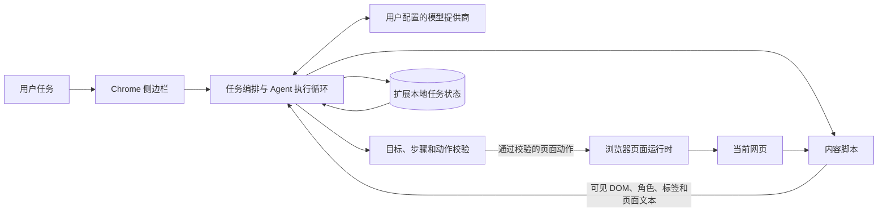

# Browser Agent 1.0 架构说明

## 目标

Browser Agent 1.0 使用当前标签页的 DOM、可访问名称、控件角色和可见文本理解网页。模型负责根据目标提出下一步；扩展运行时校验页面目标和动作，再调用浏览器接口执行。页面变化后重新读取 DOM 并验证结果，避免把模型回复本身当作任务完成证据。

## 组件与数据流

- **侧边栏**接收用户目标，展示当前阶段、活动步骤、暂停原因和最终答复。
- **任务编排器**把原始目标拆成有序步骤，管理观察、规划、执行、核验和恢复。
- **内容脚本**从当前网页提取可见文字、链接、表单字段、按钮和可访问语义，并执行通过校验的动作。
- **模型提供商**依据用户目标、当前页面证据和未完成步骤返回候选决策。网页文本作为不可信输入处理。
- **本地状态**按任务保存目标、步骤、页面证据摘要、动作结果与恢复点，使暂停后可以从新页面状态继续。

## 单个任务的执行闭环

1. **理解目标**：提取目标、约束、顺序要求和不可执行的副作用。
2. **观察页面**：读取当前标签页的 DOM 与可访问语义，形成带有稳定引用的页面快照。
3. **规划步骤**：建立可核验的任务步骤；多页面任务保留已收集的证据和尚未完成的条件。
4. **选择动作**：依据活动步骤从当前快照中定位输入框、按钮、链接或选项。
5. **运行时校验**：检查目标仍存在、控件角色合理、动作与活动步骤匹配，并应用权限和后果确认规则。
6. **执行并核验**：只执行通过校验的动作，随后重新观察页面；只有页面证据满足步骤或目标 verifier 才推进状态。
7. **恢复或暂停**：若页面无进展，基于新快照有限重规划；如果需要登录、缺少必要信息或需要用户确认，则保存检查点并等待用户。
8. **总结交付**：根据用户任务目标和已核验的页面证据组织结果；未核验的内容标记为未完成或不确定。

## 状态与连续性

任务状态使用任务标识隔离，保存原始目标、任务步骤、完成条件、已验证的页面证据、最近动作摘要和恢复点。每次继续前重新读取页面，确认已派发动作的结果后再决定下一步，避免重复执行可能有副作用的操作。任务完成后清理运行态检查点；暂停任务保留必要进度，供用户继续或取消。

## 安全边界

- 网页文本、链接和模型候选动作都不能覆盖扩展内置的安全规则。
- 页面动作必须指向当前页面快照中的目标，并经过本地规则校验。
- 登录凭据由用户在目标网站处理，智能体不会要求把密码写入任务或代码仓库。
- 发送、发布、购买、付款、删除等会产生外部影响的操作，按任务风险要求等待用户确认。
- 供应商地址、模型名称和 API 密钥由用户在扩展配置中设置；发布包不携带本机评测用的提供商配置或密钥。

## 兼容性

扩展只在浏览器允许注入脚本的网页中工作。浏览器内部页面、扩展商店、受保护页面、登录拦截和站点自身的反自动化限制可能阻止部分操作；遇到无法安全推进的情况，任务会保留进度并提示用户处理。
